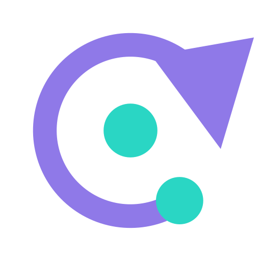

<h2 align="center">
  <br/>
  Every Node. Every Edge. Every Loop. Traced.
</h2>

<p align="center">
  <a href="LICENSE">
    
  </a>
  <a href="#getting-started">
    
  </a>
  
</p>

Orkes Watcher is an observability platform for graph-based agents. It doesn't run your
graph and it doesn't wrap your logic in a new framework — it just answers, for any run,
exactly what happened: which nodes executed, which edges were traversed, how many times a
loop re-entered, and what the state looked like at every step. Point an instrumented graph
at a project's ingest endpoint, and every run becomes an inspectable, live-updating trace.

## See it in action

**Live runs**: watch a run unfold step by step, with the node running right now highlighted.

<p align="center"></p>

**Trace inspector**: every node, edge, loop and state snapshot of a run.

<p align="center"></p>

**Dashboard**: outcomes over time, run time percentiles, slowest nodes and top errors.

<p align="center"></p>

**Teams and themes**: roles and per-project access, in light and dark mode.

<p align="center"></p>

## Getting Started

The platform itself (dashboard + ingest API) runs with one command via Docker Compose —
no separate frontend/backend setup required.

```bash
git clone <this-repo>
cd orkes-watcher
cp .env.example .env
docker compose up -d --build
```

Open `http://localhost:8080`, sign in with the bootstrap admin
(`admin@orkes.local` / `changeme` by default — see `.env.example`), and create a project
to get an ingest API key.

<details><summary>No traces to look at yet? Seed a demo project with realistic example runs.</summary>

```bash
docker compose exec backend python -m scripts.seed_example_traces
```

Populates a `support-triage` project with a few real scenarios — a happy path with a
parallel branch, a loop that retries and escalates, a run that crashes in a routing gate,
and a quick simple success — sent through the actual ingest endpoint in the orkes trace
format, not written to the database directly.
</details>

### Send traces from orkes

Attach a `WatcherSink` to your [orkes](https://github.com/hfahrudin/orkes) graph (orkes
0.1.4 or later, plain `pip install orkes`). Nothing else in your code changes:

```python
from orkes.exporters.watcher import WatcherSink

sink = WatcherSink(api_key="<project ingest key>", base_url="http://localhost:8000")
graph = OrkesGraph(SearchState, name="search", trace_sinks=[sink])
```

- `api_key`: a project key with the **ingest** scope (project → API keys).
- `base_url`: the watcher **backend** (port `8000` by default), not the dashboard. The
  project's Settings page shows the exact value.
- Sending happens in a background thread. A watcher that's down never breaks your run; at
  most the run waits up to 3 seconds at the end for its data to be sent.
- State, prompts and LLM replies are sent as they are. Pass `redact=` to strip secrets or
  personal data first.

The format is defined in the [trace contract](docs/contracts/contract-1.0.md).

## Core concepts

- **Project** — an ingest namespace (e.g. one per app or environment: production, staging,
  local). Traces sent with a project's API key land in that project.
- **Run / trace** — one execution of a graph. Identified by a run ID, with a status
  (finished, failed, running), an elapsed time, and a full record of node and edge
  traversals.
- **Graph** — the node/edge structure a run traversed: entry (`START`) and terminal (`END`)
  nodes, branches, parallel splits, and loops that can re-enter a node multiple times before
  exiting.
- **Trace inspector** — a visual graph view of a single run, where selecting a node or edge
  shows its metadata, state snapshot, and any function calls traced on that step.
- **API keys** — scoped to one project, with an ingest or read-only scope; used to
  authenticate traces sent to the platform.
- **Access / roles** — Admin, Developer, and Viewer roles control who can create projects,
  manage keys, and view traces, with per-project grants for non-admins.

## Features

- **Live trace inspector** — a graph view of a run that updates node-by-node while it's
  still executing, not just after it finishes.
- **Dashboard aggregates** — runs by outcome, slowest nodes, p95 elapsed time, edge
  traversal and loop counts per project.
- **Project-scoped API keys** — ingest or read-only, hashed at rest, shown once at
  creation.
- **Role-based access** — Admin / Developer / Viewer, with per-project membership grants
  and an invite-and-activate flow for new accounts.
- **Per-project retention & sampling** — cap how long traces are kept and drop a
  configurable share of successful (never failed) runs before they're persisted.
- **Single-command deploy** — one `docker compose up`, with the frontend's API origin
  configured at container start, not baked in at build time.

## Roadmap

| Feature | Description | Status |
|---|---|---|
| Pilot | Steer a running agent from the dashboard: pause, resume or stop it between nodes, and answer it when it asks for input. Piloted runs then show in Traces. Includes automatic reconnect for the live connection | Planned |
| Horizontal scaling | Redis-backed live fan-out across more than one backend instance | Future |

## Documentation

- **Trace contract** — the format orkes (or any sender) uses to send runs to the watcher:
  endpoint, fields, run lifecycle, response codes and versioning:
  [`docs/contracts/contract-1.0.md`](docs/contracts/contract-1.0.md). Current version: 1.0.
- **Changelogs** — what changed in each watcher release: [`docs/changelogs/`](docs/changelogs/).
  A release (every push to `main`) adds one.

Both are also shown in the app: click "Watcher X.Y.Z" or "contract N.N" at the bottom of the
sidebar.
- Backend setup, structure, migrations, and maintenance scripts:
  [`backend/README.md`](backend/README.md).

## Contributing

Contributions are welcome! Please see the [Contributing Guide](CONTRIBUTING.md).

## License

Orkes Watcher is licensed under the [MIT License](LICENSE).
